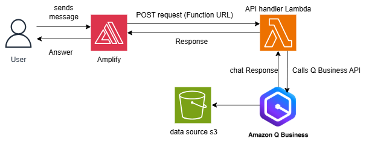

# Catholic Charities AI Assistant

A comprehensive chatbot application designed to provide users with real-time information and assistance related to Catholic Charities USA's services, powered by Amazon Q Business and featuring a user-friendly interface for seamless interaction.

This application combines natural language processing with a knowledge base of Catholic Charities USA's services and programs, delivering accurate, context-aware responses to user queries. It includes a responsive chat interface, FAQ prompts, and source attribution for transparency. The project is built with a serverless architecture using AWS services, ensuring scalability and ease of deployment.

## Disclaimers
Customers are responsible for making their own independent assessment of the information in this document.

This document:

(a) is for informational purposes only,

(b) references AWS product offerings and practices, which are subject to change without notice,

(c) does not create any commitments or assurances from AWS and its affiliates, suppliers or licensors. AWS products or services are provided "as is" without warranties, representations, or conditions of any kind, whether express or implied. The responsibilities and liabilities of AWS to its customers are controlled by AWS agreements, and this document is not part of, nor does it modify, any agreement between AWS and its customers, and

(d) is not to be considered a recommendation or viewpoint of AWS.

Additionally, you are solely responsible for testing, security and optimizing all code and assets on GitHub repo, and all such code and assets should be considered:

(a) as-is and without warranties or representations of any kind,

(b) not suitable for production environments, or on production or other critical data, and

(c) to include shortcuts in order to support rapid prototyping such as, but not limited to, relaxed authentication and authorization and a lack of strict adherence to security best practices.

All work produced is open source. More information can be found in the GitHub repo.


## Key Features

- **AI-powered responses** using Amazon Q Business
- **Responsive React-based frontend** with Material-UI components
- **Predefined FAQ prompts** for common queries
- **Source attribution** with clickable links to original content
- **Serverless backend** with AWS Lambda Function URLs (no API Gateway required)
- **Automated deployment** via AWS CodeBuild and CloudShell
- **Multi-source indexing** supporting web content and document uploads
- **Anonymous access** with CORS-enabled Lambda Function URLs
- **Real-time chat interface** with enhanced loading indicators
- **Document support** for PDF, DOCX, XLSX, and CSV files

## Architecture Overview


The application uses a modern serverless architecture:

- **Frontend**: React application hosted on AWS Amplify
- **Backend**: AWS Lambda with Function URLs for direct HTTP access
- **AI Engine**: Amazon Q Business for natural language processing
- **Data Sources**: S3-based web crawler and document indexing
- **Deployment**: Automated via AWS CDK and CodeBuild

### Architecture Features

- **Lambda Function URLs** provide direct HTTP access with simple, cost-effective operation
- **Built-in CORS handling** in Lambda functions for seamless cross-origin requests
- **Stateless chat operations** for improved scalability and reliability
- **Enhanced source attribution** with support for both web and document sources

## Repository Structure

```
.
├── Backend/                        # AWS CDK infrastructure and backend logic
│   ├── bin/                        # CDK app entry point
│   │   └── catholic-charities-cdk.ts
│   ├── data-sources/               # Data source files for indexing
│   │   ├── urls1.txt              # URLs for web crawling (Alaska, Alabama, etc.)
│   │   ├── urls2.txt              # Additional URLs for web crawling (New Jersey, etc.)
│   │   └── *.pdf, *.docx, *.xlsx, *.csv # Document files for indexing
│   ├── lambda/                     # Lambda function code
│   │   └── lambda_function.py     # Chat handler with Function URL support
│   ├── lib/                       # CDK stack definitions
│   │   └── catholic-charities-stack.ts # Main CDK stack with Lambda Function URLs
│   ├── buildspec.yml              # AWS CodeBuild configuration
│   ├── cdk.json                   # CDK configuration
│   ├── deploy.sh                  # Deployment automation script
│   ├── package.json               # Backend dependencies and scripts
│   ├── package-lock.json          # Locked dependency versions
│   ├── tsconfig.json              # TypeScript configuration
│   ├── .gitignore                 # Git ignore patterns
│   └── README.md                  # Backend-specific documentation
├── Frontend/                       # React-based web application
│   ├── public/                    # Static assets and images
│   │   ├── favicon.ico            # Browser favicon
│   │   ├── index.html             # Main HTML template
│   │   ├── manifest.json          # PWA manifest
│   │   └── robots.txt             # Search engine robots file
│   ├── src/                       # React source code
│   │   ├── Components/            # React components
│   │   │   ├── AppHeader.jsx      # Application header component
│   │   │   ├── BotReply.jsx       # Bot message display component
│   │   │   ├── ChatBody.jsx       # Main chat interface with Function URL integration
│   │   │   ├── ChatHeader.jsx     # Chat section header
│   │   │   ├── ChatInput.jsx      # User input component
│   │   │   ├── CatholicCharitiesLogo.jsx # Custom SVG logo component
│   │   │   ├── FAQExamples.jsx    # FAQ prompt buttons
│   │   │   ├── LeftNav.jsx        # Sidebar navigation
│   │   │   └── UserReply.jsx      # User message display component
│   │   ├── utilities/             # Shared utilities and configuration
│   │   │   ├── constants.js       # API endpoints and theme constants
│   │   │   ├── createMessageBlock.js # Message object creation utility
│   │   │   └── theme.js           # Material-UI theme configuration
│   │   ├── App.js                 # Main React application component
│   │   ├── App.css                # Application styles
│   │   ├── index.js               # React application entry point
│   │   └── index.css              # Global styles
│   ├── package.json               # Frontend dependencies and scripts
│   ├── package-lock.json          # Locked dependency versions
│   ├── .gitignore                 # Git ignore patterns
├── docs/                          # Documentation and assets
│   └── architecture.png           # Architecture diagram
├── LICENSE                        # Project license
└── README.md                      # Project overview and deployment guide
```

For detailed information about each component:

- **Backend**: See [Backend/README.md](Backend/README.md) for architecture details, Lambda functions, and data source management
- **Frontend**: See [Frontend/README.md](Frontend/README.md) for React components, styling, and local development

## Deployment Instructions

### Prerequisites

- **AWS Account** with permissions for:

  - Amazon Q Business
  - AWS Lambda (including Function URLs)
  - AWS Amplify
  - Amazon S3
  - AWS CodeBuild
  - IAM role/policy management

- **Amazon Q Business Setup**:
  1. Navigate to Amazon Q Business in AWS Console
  2. Create an application with **anonymous access** enabled
  3. Note the application ID for deployment

### Option 1: Automated Deployment (Recommended)

#### Using AWS CodeBuild and CloudShell

1. **Open AWS CloudShell**:

   - Click the CloudShell icon in the AWS Console navigation bar
   - Wait for the environment to initialize

2. **Clone the Repository**:

   ```bash
   git clone https://github.com/YOUR-USERNAME/Catholic-Charity-Chatbot.git
   cd Catholic-Charity-Chatbot/Backend
   ```

3. **Run Deployment Script**:

   ```bash
   chmod +x deploy.sh
   ./deploy.sh
   ```

4. **Provide Configuration**:

   - **GitHub URL**: Your forked repository URL
   - **Project Name**: Custom name (default: `catholic-charities`)
   - **Other Parameters**: Press Enter for defaults

5. **Monitor Deployment**:

   - Check AWS CodeBuild Console for build progress (~15-20 minutes)
   - Monitor CloudWatch logs for detailed information

6. **Access Application**:
   - Go to AWS Amplify Console
   - Find your application and access the provided URL
   - Test with queries like "What does Catholic Charities do?"

### Option 2: Manual CDK Deployment

#### Prerequisites

1. **AWS CLI**:

   - Install: [AWS CLI Installation Guide](https://docs.aws.amazon.com/cli/latest/userguide/install-cliv2.html)
   - Configure: `aws configure`
   - Verify: `aws --version` and `aws sts get-caller-identity`

2. **Node.js and npm**:

   - Install Node.js 18+ from [nodejs.org](https://nodejs.org/)
   - Verify: `node --version` and `npm --version`

3. **AWS CDK**:

   - Install globally: `npm install -g aws-cdk@latest`
   - Verify: `cdk --version`

4. **Required AWS Permissions**:
   - Amazon Q Business (full access)
   - AWS Lambda (including Function URLs)
   - AWS Amplify
   - Amazon S3
   - IAM (role and policy management)
   - CloudFormation
   - EventBridge

#### Steps

**Replace the placeholder values in the commands below with your actual values:**

- `<PROJECT_NAME>`: Your project name (e.g., `catholic-charities`)
- `<AWS_ACCOUNT_ID>`: Your AWS account ID (get with `aws sts get-caller-identity --query Account --output text`)
- `<AWS_REGION>`: Your AWS region (e.g., `us-west-2`)
- `<AMPLIFY_APP_NAME>`: Your Amplify app name (e.g., `<PROJECT_NAME>-frontend`)

1. **Clone and Setup Backend**:

   ```bash
   git clone https://github.com/YOUR-USERNAME/Catholic-Charity-Chatbot.git
   cd Catholic-Charity-Chatbot/Backend
   npm install
   npm run build
   ```

2. **Bootstrap CDK Environment**:

   ```bash
   cdk bootstrap \
     --context projectName="<PROJECT_NAME>" \
     --context urlFilesPath="data-sources" \
     --context dataBucketName="<PROJECT_NAME>-data-<AWS_ACCOUNT_ID>-<AWS_REGION>" \
     --context frontendBucketName="<PROJECT_NAME>-builds-<AWS_ACCOUNT_ID>-<AWS_REGION>"
   ```

3. **Deploy Backend Infrastructure**:

   ```bash
   cdk deploy CatholicCharitiesStack \
     --require-approval never \
     --context projectName="<PROJECT_NAME>" \
     --context urlFilesPath="data-sources" \
     --context dataBucketName="<PROJECT_NAME>-data-<AWS_ACCOUNT_ID>-<AWS_REGION>" \
     --context frontendBucketName="<PROJECT_NAME>-builds-<AWS_ACCOUNT_ID>-<AWS_REGION>" \
     --outputs-file outputs.json
   ```

4. **Extract Deployment Outputs**:

   ```bash
   # Get the Lambda Function URL from CDK outputs
   cat outputs.json | jq -r '.CatholicCharitiesStack.LambdaFunctionURL'
   cat outputs.json | jq -r '.CatholicCharitiesStack.FrontendBuildBucketName'

   # Note these values for the next steps
   ```

5. **Test Backend Deployment**:

   ```bash
   # Test the Lambda Function URL health endpoint (replace <LAMBDA_FUNCTION_URL> with actual URL)
   curl -X GET "<LAMBDA_FUNCTION_URL>"

   # Test chat endpoint (optional)
   curl -X POST "<LAMBDA_FUNCTION_URL>" \
     -H "Content-Type: application/json" \
     -d '{"message": "Hello, what services do you provide?"}'
   ```

6. **Create Amplify Application**:

   ```bash
   # Create Amplify app (replace placeholders with actual values)
   aws amplify create-app \
     --name "<AMPLIFY_APP_NAME>" \
     --platform WEB \
     --environment-variables "REACT_APP_API_BASE_URL=<LAMBDA_FUNCTION_URL>,REACT_APP_CHAT_ENDPOINT=<LAMBDA_FUNCTION_URL>,REACT_APP_HEALTH_ENDPOINT=<LAMBDA_FUNCTION_URL>" \
     --query 'app.appId' \
     --output text

   # Note the returned App ID for next steps
   ```

7. **Create Amplify Branch**:

   ```bash
   # Create main branch (replace <AMPLIFY_APP_ID> with actual App ID from previous step)
   aws amplify create-branch \
     --app-id "<AMPLIFY_APP_ID>" \
     --branch-name "main" \
     --stage PRODUCTION \
     --environment-variables "REACT_APP_API_BASE_URL=<LAMBDA_FUNCTION_URL>,REACT_APP_CHAT_ENDPOINT=<LAMBDA_FUNCTION_URL>,REACT_APP_HEALTH_ENDPOINT=<LAMBDA_FUNCTION_URL>"
   ```

8. **Update Amplify Deployer Lambda**:

   ```bash
   # Get the Amplify Deployer function name from outputs and update it
   aws lambda update-function-configuration \
     --function-name "$(cat outputs.json | jq -r '.CatholicCharitiesStack.AmplifyDeployerFunctionName')" \
     --environment "Variables={AMPLIFY_APP_ID=<AMPLIFY_APP_ID>,AMPLIFY_BRANCH_NAME=main}"
   ```

9. **Build and Deploy Frontend**:

   ```bash
   cd ../Frontend

   # Create production environment file (replace <LAMBDA_FUNCTION_URL> with actual URL)
   echo "REACT_APP_API_BASE_URL=<LAMBDA_FUNCTION_URL>" > .env.production
   echo "REACT_APP_CHAT_ENDPOINT=<LAMBDA_FUNCTION_URL>" >> .env.production
   echo "REACT_APP_HEALTH_ENDPOINT=<LAMBDA_FUNCTION_URL>" >> .env.production
   echo "PUBLIC_URL=" >> .env.production
   echo "GENERATE_SOURCEMAP=false" >> .env.production

   # Install dependencies and build
   npm install
   npm run build

   # Verify build
   if [ ! -f "build/index.html" ]; then
     echo "❌ ERROR: Build failed - index.html not found!"
     exit 1
   fi

   # Create deployment package
   cd build
   zip -r ../build.zip . -x "*.DS_Store" "*.map"
   cd ..

   # Upload to S3 (replace <FRONTEND_BUILD_BUCKET> with actual bucket name)
   aws s3 cp build.zip "s3://<FRONTEND_BUILD_BUCKET>/builds/build-$(date +%s).zip"

   echo "✅ Build uploaded to S3. Amplify deployment will start automatically."
   echo "📱 Amplify App URL: https://main.<AMPLIFY_APP_ID>.amplifyapp.com"
   ```

10. **Verify Deployment**:

    ```bash
    # Check Amplify deployment status (replace <AMPLIFY_APP_ID> with actual App ID)
    aws amplify list-jobs \
      --app-id "<AMPLIFY_APP_ID>" \
      --branch-name "main" \
      --max-results 1

    # Test the application at: https://main.<AMPLIFY_APP_ID>.amplifyapp.com
    ```

#### Parameter Reference

For easy reference, here are the parameters you need to replace:

| Placeholder               | Description                       | Example                                                   |
| ------------------------- | --------------------------------- | --------------------------------------------------------- |
| `<PROJECT_NAME>`          | Your project name                 | `catholic-charities`                               |
| `<AWS_ACCOUNT_ID>`        | Your AWS account ID               | `123456789012`                                            |
| `<AWS_REGION>`            | Your AWS region                   | `us-west-2`                                               |
| `<AMPLIFY_APP_NAME>`      | Your Amplify app name             | `catholic-charities-frontend`                      |
| `<LAMBDA_FUNCTION_URL>`   | Lambda Function URL from step 4   | `https://abc123.lambda-url.us-west-2.on.aws/`             |
| `<AMPLIFY_APP_ID>`        | Amplify App ID from step 6        | `d1a2b3c4d5e6f7`                                          |
| `<FRONTEND_BUILD_BUCKET>` | Frontend build bucket from step 4 | `catholic-charities-builds-123456789012-us-west-2` |

## Usage

### Data Source Management

1. **Web Content Indexing**:

   - Add URLs to `Backend/data-sources/urls1.txt`
   - Each URL on a new line
   - Supports up to 100 URLs per file

2. **Document Upload**:

   - Place PDF, DOCX, XLSX, or CSV files in `Backend/data-sources/`
   - Files are automatically indexed during deployment
   - Supports various document formats

3. **Sync Data Sources**:
   - Navigate to Amazon Q Business Console
   - Select your application
   - Trigger sync jobs for updated content

### Application Access

1. **Chat Interface**:

   - Access via the Amplify-provided URL
   - Use the chat input or click FAQ prompts
   - View sources by clicking "Show Sources" under responses

2. **API Endpoints**:
   - **Chat**: `POST` to Lambda Function URL with `{"message": "your question"}`
   - **Health Check**: `GET` to Lambda Function URL for status

## Technical Architecture

### Data Flow

```
User Query → Amplify Frontend → Lambda Function URL → Amazon Q Business → Indexed Content
     ↑                                                           ↓
     └────────────────────── Response with Sources ───────────────┘
```

### Component Interactions

1. **User Interface**: React frontend hosted on AWS Amplify
2. **API Layer**: Lambda Function URLs with built-in CORS support for direct HTTP access
3. **AI Processing**: Amazon Q Business processes queries against indexed content
4. **Data Storage**: S3 buckets store source documents and web crawler data
5. **Content Indexing**: Automated data source creation and synchronization

### AWS Services Used

- **Amazon Q Business**: AI-powered chat and content indexing
- **AWS Lambda**: Serverless compute with Function URLs
- **AWS Amplify**: Frontend hosting and deployment
- **Amazon S3**: Document storage and web crawler data
- **AWS CodeBuild**: Automated deployment pipeline
- **EventBridge**: Deployment automation triggers
- **IAM**: Security and access management

### Environment Variables

#### Lambda Function

- `QBUSINESS_APPLICATION_ID`: Amazon Q Business application identifier
- `DEBUG`: Enable detailed error logging (optional)

#### Amplify Frontend

- `REACT_APP_API_BASE_URL`: Lambda Function URL
- `REACT_APP_CHAT_ENDPOINT`: Chat endpoint (same as base URL)
- `REACT_APP_HEALTH_ENDPOINT`: Health check endpoint (same as base URL)

## Troubleshooting

### Common Issues

1. **Lambda Function URL Errors**:

   - **Error**: "Function URL not accessible"
   - **Solution**: Verify CORS configuration and Function URL permissions
   - **Check**: Lambda Function URL is properly configured with anonymous access

2. **Q Business Integration Issues**:

   - **Error**: "Access denied to Q Business"
   - **Solution**: Verify IAM roles and Q Business application permissions
   - **Check**: `QBUSINESS_APPLICATION_ID` environment variable is set correctly

3. **Data Source Sync Problems**:

   - **Error**: "Sync job failed"
   - **Solution**: Check URL accessibility and document formats
   - **Monitor**: Amazon Q Business Console for sync job status

4. **Frontend Configuration Issues**:
   - **Error**: "API endpoints not configured"
   - **Solution**: Ensure environment variables are set in Amplify
   - **Verify**: Function URL is accessible and returns proper CORS headers

### Manual Deployment Troubleshooting

1. **CDK Bootstrap Issues**:

   - **Error**: "CDK bootstrap failed"
   - **Solution**: Ensure AWS credentials are configured and have sufficient permissions
   - **Check**: Run `aws sts get-caller-identity` to verify credentials

2. **Missing Context Parameters**:

   - **Error**: "Context parameter not found"
   - **Solution**: Ensure all required context parameters are passed to CDK commands
   - **Required**: `projectName`, `urlFilesPath`, `dataBucketName`, `frontendBucketName`

3. **S3 Bucket Name Conflicts**:

   - **Error**: "Bucket already exists"
   - **Solution**: Use unique bucket names by including account ID and region
   - **Format**: `${PROJECT_NAME}-data-${AWS_ACCOUNT}-${AWS_REGION}`

4. **Amplify App Creation Issues**:

   - **Error**: "Failed to create Amplify app"
   - **Solution**: Check IAM permissions for Amplify service
   - **Verify**: Ensure the app name is unique in your account

5. **Build Upload Issues**:

   - **Error**: "S3 upload failed"
   - **Solution**: Verify S3 bucket exists and you have write permissions
   - **Check**: Ensure the build.zip file was created successfully

6. **Environment Variable Issues**:
   - **Error**: "jq: command not found"
   - **Solution**: Install jq: `sudo apt-get install jq` (Linux) or `brew install jq` (macOS)
   - **Alternative**: Manually extract values from outputs.json

### Debugging Steps

1. **Check CloudWatch Logs**: Monitor Lambda function execution logs
2. **Verify Environment Variables**: Ensure all required variables are set
3. **Test Function URL**: Use curl or Postman to test Lambda Function URL directly
4. **Monitor Q Business**: Check application status and data source sync jobs

## Adding Content Sources

### Web URLs

1. Edit `Backend/data-sources/urls1.txt`
2. Add new URLs (one per line)
3. Redeploy or trigger manual sync in Q Business Console

### Documents

1. Place files in `Backend/data-sources/` directory
2. Supported formats: PDF, DOCX, XLSX, CSV
3. Redeploy to create new data sources automatically

### Limits

- Up to 50 data sources per Q Business application
- Up to 100 URLs per web crawler data source
- Document size limits apply per AWS Q Business quotas

## Security Considerations

- **Anonymous Access**: Application uses anonymous access for simplicity
- **CORS Configuration**: Properly configured for cross-origin requests
- **IAM Roles**: Least privilege access for all AWS services
- **Public S3 Access**: Data bucket allows public read for document sources
- **HTTPS Only**: All communications use HTTPS encryption

## Maintenance

- **Monitor Costs**: Track usage of Q Business and Lambda Function URLs
- **Update Dependencies**: Regularly update Node.js and Python packages
- **Review Logs**: Monitor CloudWatch for errors and performance issues
- **Content Updates**: Keep data sources current with regular sync jobs

## Contributing

1. Fork the repository
2. Create a feature branch: `git checkout -b feature/your-feature`
3. Commit changes: `git commit -m "Add your feature"`
4. Push and create a pull request: `git push origin feature/your-feature`

## License

This project is licensed under the MIT License.

## Contact

For support, contact [support@catholiccharitiesusa.org](mailto:support@catholiccharitiesusa.org).
